 

 

- 🛠️ **Frontend Engineer** at **Dharma Angels**, building **MeditationTTC**, a 12-week live online meditation teacher training
- 🧱 Previously **Frontend Engineer Intern at SpeakGenie**, where I was **Lead Frontend Engineer** for our team at the **Google AI Hackathon**
- 🎓 **AWS Business Intelligence Engineer Nanodegree** and **AWS AI & ML** scholar at *Udacity*, plus **Responsive Web Design** certified by *freeCodeCamp*
- 🎯 **Focus:** backend engineering, AI systems, and STEM & CS foundations
- 🤖 **Exploring next:** Udacity's **Autonomous Systems School**, with a pull toward robotics, self-driving cars, and autonomous flight
- 🤝 **Open to:** open-source collaboration, real-world tech ideas, and chats about AI, robotics & innovation

> ⚡ **Fun fact:** As a kid I built robots out of paper. My mom and sister kept throwing them away, but my dad and brother didn't. 😄

 

**Shipping with**

**Learning right now**

 

> I'm moving from frontend into **full-stack, SaaS, and AI engineering**, and I'm learning in public. This is the path I'm on:

<b>📚 The full learning list (click to expand)</b>

 

- **Backend:** NestJS · OOP · Auth · RBAC · Clean Code · Testing · Industry Best Practices
- **Data:** SQL · PostgreSQL · Drizzle ORM · Redis · Vector Databases · Database Design Techniques
- **Architecture:** Multi-tenant Architecture · SaaS Product Development · System Design · Scalability
- **AI:** LLMs · RAG · LangChain · Multi-Agent Systems · Prompt Engineering · Tool Calling · AI Guardrails · Embeddings
- **DevOps:** Docker · Multi-Container Applications · NGINX · AWS · GitHub Actions · CI/CD · VPS

 

Paper robots as a kid, real robots someday. I'm interested in Udacity's **Autonomous Systems School** and the paths it opens up.

| 🦾 Robotics Software Engineer | 🚗 Self-Driving Car Engineer | 🚁 Autonomous Flight Engineer |
| :-: | :-: | :-: |
| Perception, localization, and navigation | Sensors, vision, and driving software | Drones, flight control, and autonomy |

 

 

More projects, my resume, and certifications live on my portfolio: **[shuvodipdashimu.vercel.app](https://shuvodipdashimu.vercel.app/)**

 

 

  

  

<picture>
  <source media="(prefers-color-scheme: dark)" srcset="https://raw.githubusercontent.com/ShuvodipDasHimu/ShuvodipDasHimu/output/github-snake-dark.svg" />
  <source media="(prefers-color-scheme: light)" srcset="https://raw.githubusercontent.com/ShuvodipDasHimu/ShuvodipDasHimu/output/github-snake.svg" />
  
</picture>

 

I'm always open to **feedback, collaboration, and new ideas**, especially around web apps, AI, and open source. If something here sparks a thought, reach out.

