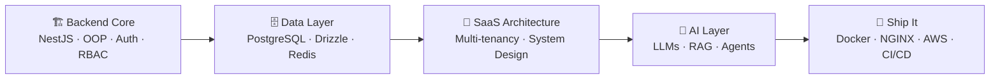

<!-- ═══════════════ HEADER ═══════════════ -->

 

 

## 👨‍💻 About Me
 🛠️ Frontend Engineer at Dharma Angels, building MeditationTTC, a 12-week live online meditation teacher training
 🧱 Previously Frontend Engineer Intern at SpeakGenie, where I was Lead Frontend Engineer for our team at the Google AI Hackathon
 🎓 AWS Business Intelligence Engineer Nanodegree and AWS AI & ML scholar at Udacity, plus Responsive Web Design certified by freeCodeCamp
 🎯 Focus: Fullstack engineering, AI systems, and STEM & CS foundations
 🤝 Open to: open-source collaboration, real-world tech ideas, and chats about AI, robotics & innovation

> ⚡ **Fun fact:** As a kid I built robots out of paper. My mom and sister kept throwing them away, but my dad and brother didn't. 😄

 

## 🧰 Tech Stack

| | |
| :-- | :-- |
| **🗣️ Languages** |     |
| **🖥️ Frontend** |    |
| **⚙️ Backend & Services** |     |
| **🧰 Workflow** |    |
| **🤖 AI Tools** |    |

 

## 🌱 Currently Leveling Up

> I'm moving from frontend into **full-stack, SaaS, and AI engineering**. Here's the path I'm on, and I'm learning in public.

| 🏗️ Backend Core | 🗄️ Data Layer | 🧠 AI Layer | 🚢 DevOps |
| :-: | :-: | :-: | :-: |
|  |  |  |  |
|  |  |  |  |
|  |  |  |  |
|  |  |  |  |
|  |  |  |  |

<b>📚 The full learning list (click to expand)</b>

 

- **Backend:** NestJS · OOP · Auth · RBAC · Clean Code · Testing · Industry Best Practices
- **Data:** SQL · PostgreSQL · Drizzle ORM · Redis · Vector Databases · Database Design Techniques
- **Architecture:** Multi-tenant Architecture · SaaS Product Development · System Design · Scalability
- **AI:** LLMs · RAG · LangChain · Multi-Agent Systems · Prompt Engineering · Tool Calling · AI Guardrails · Embeddings
- **DevOps:** Docker · Multi-Container Applications · NGINX · AWS · GitHub Actions · CI/CD · VPS

 

## 🚀 Featured Work

| Project | What it is | |
| :-- | :-- | :-: |
| 🪷 **Dharma Angels** | Conscious-tech product, built end to end | [**Visit →**](https://dharmaangels.com/) |
| 🩺 **AlignCare** | Health appointment platform, clean and responsive | [**Visit →**](https://aligncare.dharmaangels.com/) |
| 🧘 **MeditationTTC** | 12-week live online meditation teacher training | [**Visit →**](https://meditationttc.vercel.app/) |

More projects, my resume, and certifications live on my portfolio:
**[shuvodipdashimu.vercel.app](https://shuvodipdashimu.vercel.app/)**

 

## 📊 GitHub Stats

 

 

## 🤝 Let's Connect

I'm always open to **feedback, collaboration, and new ideas**, especially around web apps, AI, and open source. If something here sparks a thought, reach out.

 

*"What is unknown can be known through me."* 🚀

